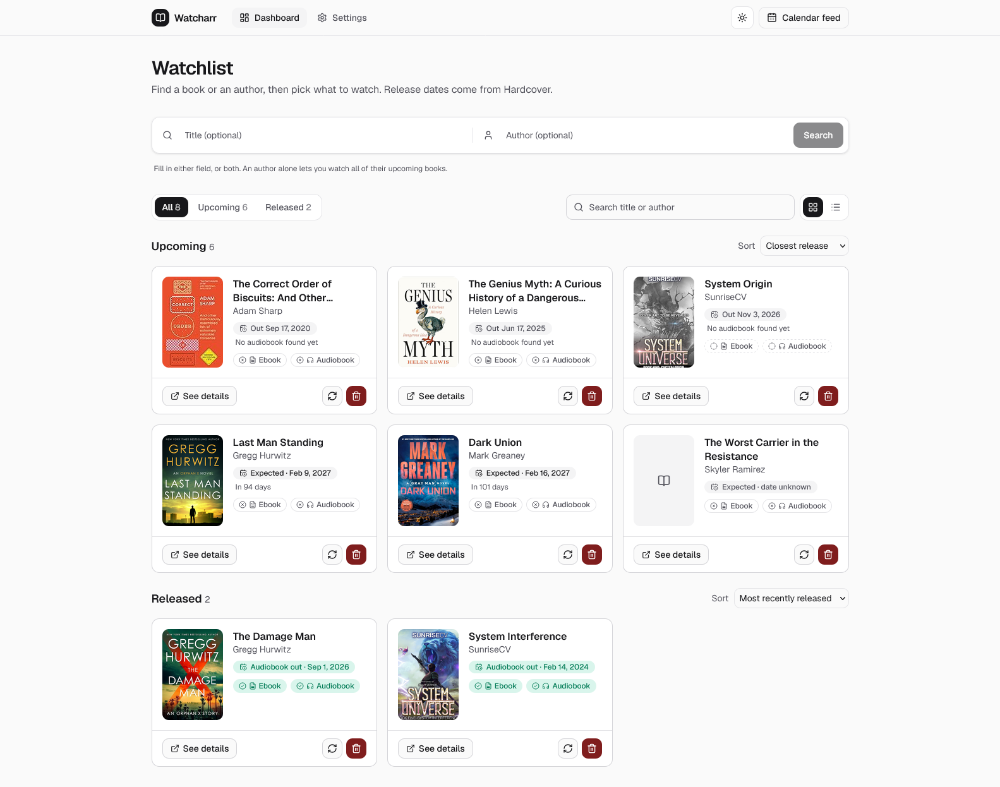
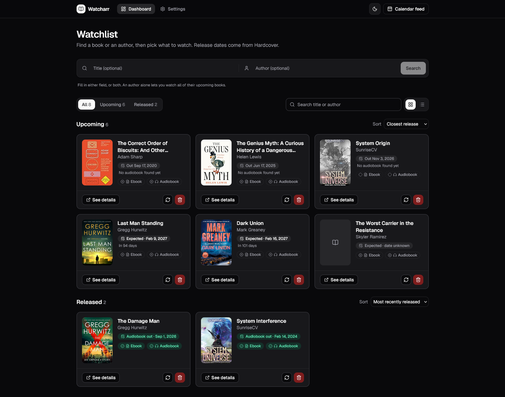
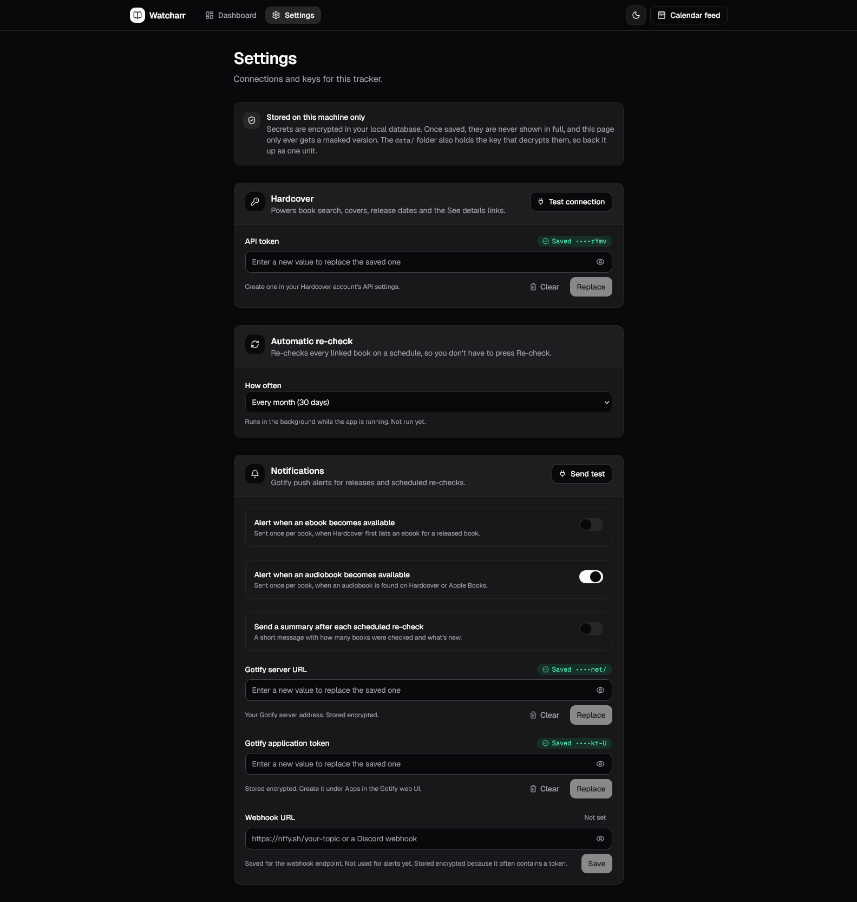

# Watcharr

A self-hosted tracker for books and authors. Add a book or follow an author, and Watcharr tells you when the ebook or audiobook is out. It runs on your own machine, and your data stays in a local SQLite database.



<details>
<summary>Dark mode and settings</summary>





</details>

> **Vibe-coded disclaimer.** Watcharr was written with AI assistance (Claude Code) and was built by iterating on a real watchlist. It hasn't had a security audit or a full test suite. Read the code before you trust it with anything important, and don't expose it to the internet. Use it at your own risk. See [LICENSE](LICENSE).

## Features

- **Watchlist.** Search by title, author, or both. Pick the right match from the results, or follow an author to watch all of their upcoming books.
- **Release tracking.** Release dates and formats come from [Hardcover](https://hardcover.app). If Hardcover lists no audiobook for a book that's already out, Watcharr double-checks [Apple Books](https://books.apple.com) through the public iTunes Search API.
- **Upcoming and Released groups.** A book counts as released once an audiobook is available. Each group has its own sort order and a search box.
- **Alerts.** Send [Gotify](https://gotify.net) push notifications when an ebook or audiobook becomes available. You can also send a summary after each scheduled re-check. Each alert type can be switched on or off.
- **Automatic re-check.** Choose daily, every 7 days, every month (the default), or every 3 months.
- **Calendar feed.** An `.ics` file of expected release dates that you can subscribe to from any calendar app.
- **Themes.** Light, dark, or system, from the icon at the top right.
- **Encrypted settings.** Your Hardcover token, Gotify URL and token, and other personal settings are encrypted in the database and shown masked after you save them.

**What Watcharr doesn't do:** it doesn't search piracy sites or link to download pages. Format availability comes only from Hardcover and Apple Books.

## Quick start

Requirements: Node.js 20.9 or newer (Next.js 16 minimum), and npm.

```bash
git clone https://github.com/<your-username>/watcharr.git
cd watcharr
npm install
npm run dev
```

Open http://localhost:4242, then go to **Settings** and:

1. Paste your **Hardcover API token** and click **Test connection**. You create the token in your Hardcover account settings.
2. Optional: add a **Gotify server URL** and **application token**, then click **Send test**.

For a production build, run `npm run build && npm start`. It also serves on port 4242.

## Configuration

Copy `.env.example` to `.env.local` if you want to change the defaults.

| Variable | Default | Purpose |
| --- | --- | --- |
| `APP_SECRET_KEY` | generated | 32-byte base64 key for encrypting settings. If unset, a random key is created in `data/.secret-key`. |
| `DB_DIR` | `./data` | Folder for the SQLite database and the key file. |

Keep `data/` private and back it up as one unit. The database holds your watchlist, and the key file decrypts your saved tokens.

## How it works

- **Hardcover** is the primary source for release dates, ebook and audiobook editions, covers, and the See details link.
- **Apple Books** is a secondary source for audiobooks only. It runs when Hardcover reports no audiobook for a released book. A result only counts if the title and the author's surname both match.
- **Re-check** refreshes one book on demand. The scheduler does the same for every linked book at the interval you chose. The scheduler runs while the app is running. It doesn't run if the server is off.
- **Alerts** fire only when a format changes from known-unavailable to available, so the first check of a book doesn't alert for formats that were already out.

## Development

| Command | What it does |
| --- | --- |
| `npm run dev` | Dev server on http://localhost:4242 |
| `npm run build` | Production build |
| `npm start` | Serve the production build on port 4242 |
| `npm run lint` | ESLint |
| `npm run db:push` | Apply schema changes with drizzle-kit (see note below) |

Schema notes: `drizzle-kit push` has been unreliable on some schema changes. If it fails, back up `data/` first and check the change by hand.

### Project layout

```
src/
  app/            Pages (landing, dashboard, settings) and API routes
  components/     UI components (shadcn/ui based) and the site header
  db/schema.ts    Drizzle schema for SQLite
  lib/            Hardcover client, Apple Books lookup, Gotify, scheduler, encryption
  instrumentation.ts  Starts the re-check scheduler when the server starts
data/             Local database and key file (gitignored)
```

### Tech stack

Next.js (App Router), React, TypeScript, Tailwind CSS, shadcn/ui, Drizzle ORM with better-sqlite3, Zod, and lucide-react.

## Known issues

- `npm audit` reports 12 moderate vulnerabilities in development tooling (`drizzle-kit`'s esbuild and the ESLint toolchain). They don't affect the production build. The suggested fix downgrades `drizzle-kit`, so I haven't applied it.
- On Windows, the owner-only file mode for `data/.secret-key` isn't enforced. Protect the folder with your user-profile permissions.
- Watcharr has no login. Run it on a machine you control.

See [SECURITY.md](SECURITY.md) for how secrets are handled and how to report a vulnerability.

## Contributing

Issues and pull requests are welcome. Keep changes focused, run `npm run lint` and `npm run build` before you open a pull request, and describe user-visible changes in the pull request.

## License

[MIT](LICENSE). Copyright (c) 2026 Ravi Warrier.
